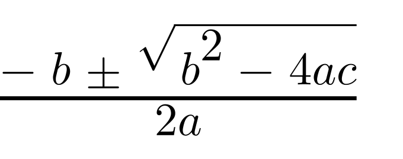

# mathengine

一个只做**数学模式**的轻量 LaTeX 排版引擎，用 Rust 写成，2574 行，58 个单元测试。

输入是一段 LaTeX 公式，输出是**扁平的绘制指令**：每个字形的码位、位置、缩放，加上分数线与根号横线的矩形。渲染层不需要理解 TeX，照着画即可。



以上图形不是截图拼的，是 `examples/render_svg.rs` 直接读取本引擎输出的布局指令、再向字体索取字形轮廓画出来的。

## 为什么重新造一个

移动端可用的 LaTeX 渲染方案主要有两类，各有硬伤。

| 方案 | 问题 |
|---|---|
| jlatexmath | GPL-2.0，接进 Android 应用会让整个应用变成 GPL 派生作品；依赖 JVM，启动与体积开销大 |
| KaTeX / MathJax | 需要 WebView 或 JS 运行时，在手表这类设备上不可行 |
| 各家自研闭源实现 | 拿不到，也无法验证 |

本项目只依赖 `ttf-parser` 一个 crate，可以编成静态库或 `.so` 嵌入任何宿主，没有运行时依赖，也不用 WebView。

## 支持范围

**已支持**：分式（`\frac`、`\cfrac`、`\binom`、`\tbinom`）、根号与任意次根（`\sqrt`、`\root`）、上下标（含多层嵌套与并排）、大运算符带上下限（`\sum`、`\prod`、`\int` 等）、`\left` / `\right` 自适应括号、矩阵与 `\begin` / `\end` 环境、`\operatorname`、重音（`\hat`、`\widetilde`、`\overline`、`\underline`）、间距微调、希腊字母与常用符号、中英文混排（非 ASCII 字符当字面字符处理）。

**明确不支持**：整页排版、段落断行、颜色与背景、图片插入、TikZ 等绘图宏包、`\def` 自定义宏、化学式宏包。

**未知命令的处理**：宽容，不抛错，按字面渲染。宁可显示得难看，不要整段公式渲染失败。

## 架构

```
LaTeX 串
  → token       按数学模式规则切词（命令 / 单字符 / 分组 / 上下标）
  → ast         递归下降构建 AST（原子序列 + 分式 / 根式 / 上下标 / 矩阵节点）
  → layout      TeX Box 布局：基线对齐、脚本缩放 1.0/0.7/0.5、分数线位置、根号尺寸
  → 扁平指令    字形数组 + 横线矩形 + 整体宽度 / 高度 / 深度
```

字体度量通过 `ttf-parser` 直接读 OpenType 的 `cmap`、`hmtx` 与 `MATH` 表，不使用 HarfBuzz，也不做完整 OpenType 排版。

## 构建与测试

```bash
cargo test                 # 58 个单元测试，无需 JDK / NDK / 网络
cargo run --example preview -- 'x^2 + \frac{a}{b}'    # ASCII 网格预览
cargo run --example dump_json -- '\sqrt{x}'           # 输出布局指令 JSON
cargo build --release                                  # 产出 rlib 与 cdylib
```

Android 端需要 JNI 导出时才打开 feature：

```bash
cargo build --release --features jni --target aarch64-linux-android
```

## 跨端

核心完全是平台无关的 Rust：只用 `std` + `ttf-parser`，没有任何 `cfg(target_os)` 分支，不碰文件系统以外的系统调用，输出是纯数据结构。

- **能跨**：Linux、macOS、Windows、Android、iOS，以及任何能跑 Rust 的宿主。
- **已验证**：本机 x86_64 Linux 实际构建与测试；CI 对 Linux / macOS / Windows 三平台跑同一套测试。
- **未验证**：iOS、WASM、以及 Android 真机上的 aarch64 构建。
- **不跨的部分**：`jni.rs` 是 Android 专用，由 feature 开关控制，默认不编译。C ABI（`ffi.rs`）是通用的，非 Android 宿主也应该走这条。

## 作为 C 库使用

```c
ArixMathLayout* arix_math_layout(const char* latex, const uint8_t* font, size_t font_len);
ArixMathLayout* arix_math_layout_from_path(const char* latex, const char* font_path);
void arix_math_free(ArixMathLayout* layout);
```

返回结构是一块定长头加若干只读数组，字段布局见 `src/ffi.rs` 顶部注释。调用方读完必须调 `arix_math_free`。

## 限制与已知不足

- 只做数学模式，不支持整页排版与断行。
- 只支持 Latin Modern Math 一档字体的度量，换字体需要验证 `MATH` 表常量是否被正确读取。
- 脚本缩放的阈值是固定比例，未按字体配置表动态读取。
- 不处理连字与字距调整（kerning），复杂公式的字形间距会略宽于 TeX 原版。
- 未做性能优化，布局开销未在低端设备上实测。

## 数据

| 项 | 值 |
|---|---|
| Rust 源码行数 | 2574 |
| 单元测试 | 58 个 |
| 集成测试 | 7 个（只走公共 API） |
| 运行时依赖 | 无（仅 `ttf-parser` 编译期依赖） |
| 附带字体 | Latin Modern Math，约 720 KB |
| 布局耗时（本机，15 条公式 30000 次采样） | 中位 3.04 µs，p95 8.23 µs |
| 与 jlatexmath 1.0.7 对比 | 整体约快 1.5 倍，矩阵快 5 倍，求和略慢 |

完整的测量方法、逐条对照与体积对比见 [`docs/EXPERIMENTS.md`](docs/EXPERIMENTS.md)。体积一项本引擎不占优，文档里写明了原因与改进方向。

## 许可与致谢

代码以 **AGPL-3.0-or-later** 发布，见 `LICENSE`。本项目从 Arix（OnyxAI）主仓库的 `mathengine/` 模块拆出独立维护。

字体为 Latin Modern Math，来自 GUST 字体项目，按其自身许可分发，见 `assets/NOTICE`。
